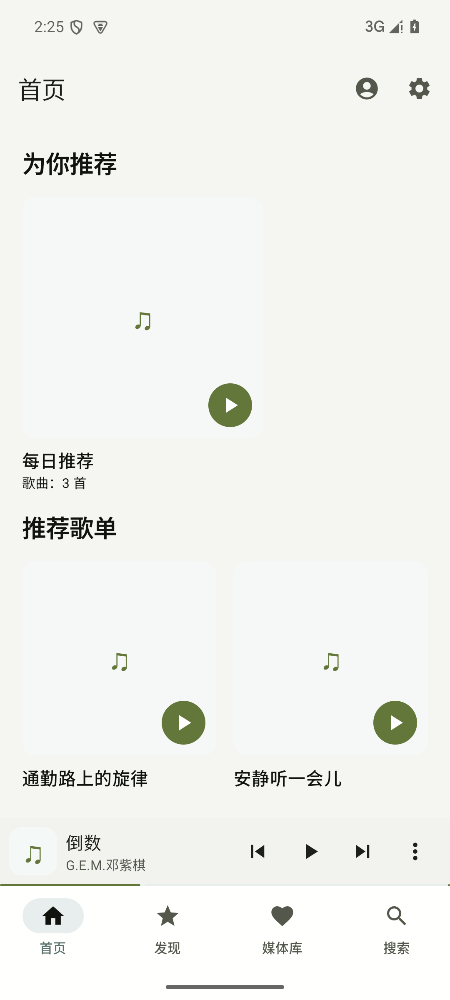
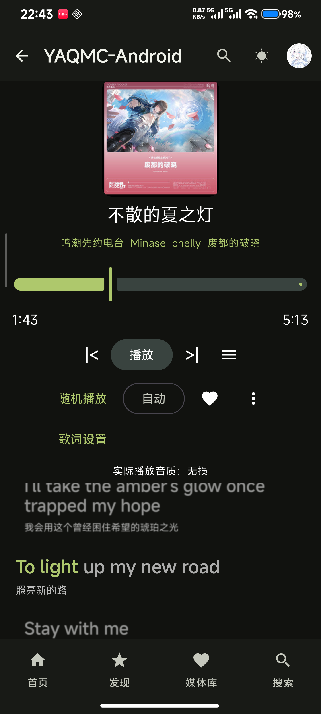
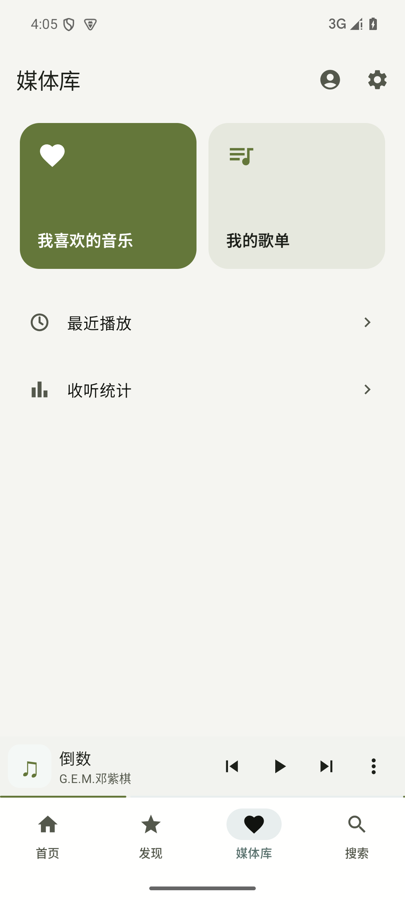

# YAQMC-Android

**轻量版 QQ 音乐，专注日常听歌。**

基于 [YAQMC](https://github.com/YAQMC/YAQMC) 的非官方 Android 客户端，面向希望继续使用 QQ 音乐会员、又想要更简洁听歌体验的用户。

[下载安卓版](https://github.com/ltzu929/YAQMC/releases/tag/v0.1.5) · [版本记录](https://github.com/ltzu929/YAQMC/releases) · [问题反馈](https://github.com/ltzu929/YAQMC/issues)

## 界面预览

|                                                    首页与推荐                                                     |                                                    播放器与歌词                                                     |                                                     媒体库                                                      |
| :---------------------------------------------------------------------------------------------------------------: | :-----------------------------------------------------------------------------------------------------------------: | :-------------------------------------------------------------------------------------------------------------: |
|  |  |  |

首页与媒体库使用示例数据。

## 功能

- QQ 音乐账号登录、会员信息、收藏和歌单管理。
- 搜索歌曲，浏览推荐、专辑、歌手和音乐库，切换页面保留搜索条件与列表位置。
- 独立播放页，封面与歌词左右滑动切换，支持逐字歌词与外观设置。
- 播放队列、会员权益范围内的音质选择。
- 后台播放、系统媒体控制、缓存管理和听歌统计。

## 后续方向

以 QQ 音乐作为日常主曲库，通过 B 站收藏夹补充 QQ 音乐没有的翻唱、现场等版本。计划读取用户选定的收藏夹，只播放视频中的音频。

**B 站收藏音频尚未接入，当前安装包不包含此功能。**

## 下载与安装

当前提供 **`0.1.5` 正式版**，下载入口见[发布页面](https://github.com/ltzu929/YAQMC/releases/tag/v0.1.5)。

- 系统：Android 8.0 及以上。
- 架构：ARM64（`arm64-v8a`）。
- 下载并安装发布页中的 `.apk` 文件；版本名称与日期可在该页面查看。
- 支持覆盖安装，保留登录和本地数据。

## 从源码构建

界面使用 Kotlin / Jetpack Compose，底层复用 Rust Core。

克隆完整仓库，在 Android Studio 中打开 `apps/android/android`。按[开发指南](apps/android/android/docs/development.md)配置 JDK、Android SDK / NDK 和 Rust 后，运行 `:nativeApp:assembleDebug` 即可生成包含完整 Rust Core 的开发版 APK。

开发版使用独立包名和本机调试签名，无需维护者的私有密钥。构建命令、依赖版本和测试方法见开发指南。

## 反馈

使用问题和建议请提交到 [Issues](https://github.com/ltzu929/YAQMC/issues)。请附上应用版本、系统版本和复现步骤，日志中不要包含账号凭据或私人信息。

## 来源与许可

本项目基于 YAQMC 开发，与腾讯或 QQ 音乐没有从属或合作关系，歌曲访问和音质取决于账号权益及原平台限制。

项目采用 [GPL-3.0-or-later](LICENSE)。上游及第三方来源见[鸣谢](ACKNOWLEDGEMENTS.md)、[第三方声明](THIRD_PARTY_NOTICES.md)和[对应源码说明](CORRESPONDING_SOURCE_POLICY.md)。
