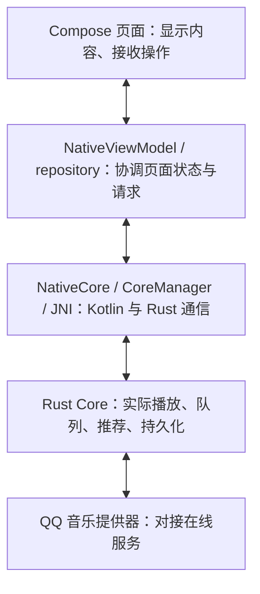

# 开发指南

方向、范围与关键决定看[项目规划](project-plan.md)，能力覆盖和验收看[迁移对齐清单](native-parity.md)。本文维护实际开发所需的结构、命令与工作方式。

## 先认清两个目录入口

**完整仓库根目录叫 `YAQMC`，Android Studio 日常打开的是其中的 `apps/android/android`。** 三份中文主文档放在 Android 工程内的 `docs/`，可以直接从左侧项目树阅读。

在左侧选择“项目”视图，展开 `android [yaqmc-android] → docs`，双击 `project-plan.md` 看规划、`development.md` 看本指南、`native-parity.md` 看功能与验收。Markdown 编辑区右上角可切换预览；本文中的文档和源码链接可继续导航。仓库根目录的 [README.md](../../../../README.md) 仍作为完整项目总入口。

### 完整项目的主要目录

```text
YAQMC/                         完整仓库根目录
├── README.md                  项目总入口
├── docs/                      保留的许可、协议与来源资料
├── apps/android/android/      Android Studio 打开的 Gradle 工程
│   ├── docs/                  规划、开发指南、能力与验收清单（左侧直接阅读）
│   └── nativeApp/             手机应用模块：界面、Android 系统接入及测试
├── crates/                    Rust 核心、QQ 音乐接入及通信协议
├── assets/                    品牌资源
├── scripts/                   构建、检查等辅助脚本
├── .github/                   PR 模板及自动检查工作流
├── Cargo.toml / Cargo.lock    Rust 模块、依赖及锁定版本
└── package.json               应用版本和可选工具命令
```

当前是一个 Android 应用，Kotlin 负责界面和 Android 系统接入，Rust 核心承担播放及相关业务能力。`package.json` 保留版本和工具命令，Gradle 打包会读取其中的版本号；当前界面使用 Compose。

### Android Studio 左侧这些项目是什么

下表路径都相对于 `apps/android/android`。IDE 显示的 `android [yaqmc-android]` 是 Gradle 工程；`yaqmc-android.nativeApp` 是 IDE 的模块名称，对应实际的 `nativeApp/` 目录。模块可以理解为工程中参与构建的一部分；当前应用模块只有 `:nativeApp`。

| 名称                                                 | 做什么                                                 | 日常如何看待                             |
| ---------------------------------------------------- | ------------------------------------------------------ | ---------------------------------------- |
| `docs/`                                              | 三份中文主文档的实际位置                               | 直接展开并双击阅读，文档只维护这一份正文 |
| `nativeApp/`                                         | 手机应用源码、资源、测试和模块构建配置                 | 查找功能实现时主要展开这里               |
| `gradle/`、`gradlew`、`gradlew.bat`                  | 固定 Gradle 版本并启动构建；`.bat` 用于 Windows        | 构建工具入口，使用仓库已有版本           |
| `settings.gradle.kts`                                | 声明包含哪些模块及从哪里获取依赖                       | 当前包含 `:nativeApp`                    |
| `build.gradle.kts`                                   | 工程级构建插件配置；`nativeApp` 内同名文件负责应用配置 | 版本、依赖和打包问题会涉及这些文件       |
| `gradle.properties`                                  | Gradle 构建选项                                        | 调整构建环境时查看                       |
| `.run/`                                              | 共享的运行、检查、模拟器测试和打包配置                 | 对应顶部运行配置下拉框                   |
| `.idea/`                                             | Android Studio 的工程与本机界面配置                    | 由 IDE 管理，功能代码不放这里            |
| `.codex/`                                            | 本机 Codex / MCP 工具配置                              | 助手连接工具时使用                       |
| `.gradle/`、`.kotlin/`                               | 构建和 Kotlin 编译缓存                                 | 由工具生成，阅读功能时可跳过             |
| `build/`、`nativeApp/build/`                         | 编译中间文件、报告和生成的 APK                         | 查构建结果时使用；修改源码应回到 `src/`  |
| `local.properties`                                   | 本机 SDK、Cargo 等路径                                 | 配置环境时使用，保持本机私有             |
| `keystore.properties`、`keystore.properties.example` | 本机签名配置及其填写示例                               | 常规升级沿用已有签名，真实配置保持私有   |

### 展开 nativeApp 后，源码在哪里

```text
nativeApp/
├── src/
│   ├── main/                           实际打进应用的代码和资源
│   │   ├── AndroidManifest.xml         应用入口、权限、媒体服务等声明
│   │   ├── java/org/yaqmc/android/
│   │   │   ├── nativeui/              Compose 页面、界面状态和偏好设置
│   │   │   ├── core/                  Rust 核心宿主、登录协调和凭据保存
│   │   │   ├── media/                 通知、系统媒体控制、音频焦点和后台服务
│   │   │   ├── update/                更新检查
│   │   │   ├── OAuthActivity.kt       授权登录页面
│   │   │   └── YaqmcApplication.kt    应用进程初始化
│   │   └── res/                       文案、图标、主题和其他 Android 资源
│   ├── test/                          在电脑上运行的 JVM 单元测试
│   └── androidTest/                   需要模拟器或手机运行的设备测试
├── build.gradle.kts                   应用依赖、版本、Rust 构建和签名配置
└── build/                             自动生成的构建结果
```

这里的 `java/` 也存放 Kotlin 的 `.kt` 文件。Compose 页面主要用 Kotlin 描述布局，界面代码从 `nativeui/` 找；`res/values/` 与 `res/values-zh-rCN/` 分别提供默认与简体中文资源。

### 想改一个功能，先从哪里找

下表给出代码入口；能力范围和验收状态仍在[对齐清单](native-parity.md#按功能查进展)维护。Kotlin 文件均在上图的 `java/org/yaqmc/android/` 下。

| 想查看或改善的功能                                   | 主要代码入口                                                                                                                                                                                                                                                                                                                                                                                   | 对齐编号                                |
| ---------------------------------------------------- | ---------------------------------------------------------------------------------------------------------------------------------------------------------------------------------------------------------------------------------------------------------------------------------------------------------------------------------------------------------------------------------------------- | --------------------------------------- |
| 应用启动、导航、顶部入口与返回                       | [NativeActivity](../nativeApp/src/main/java/org/yaqmc/android/nativeui/NativeActivity.kt)、[NativeApp](../nativeApp/src/main/java/org/yaqmc/android/nativeui/NativeApp.kt)、[NativeViewModel](../nativeApp/src/main/java/org/yaqmc/android/nativeui/NativeViewModel.kt)                                                                                                                        | N01–N03                                 |
| 首页、发现、搜索、歌曲 / 专辑 / 歌单详情与音乐库列表 | [NativeCatalog](../nativeApp/src/main/java/org/yaqmc/android/nativeui/NativeCatalog.kt)、[NativeCatalogRepository](../nativeApp/src/main/java/org/yaqmc/android/nativeui/NativeCatalogRepository.kt)                                                                                                                                                                                           | H01–H02、D01–D02、S01–S04、C01–C05、A03 |
| 登录、会员资料、收藏和歌单操作                       | [NativeAccount](../nativeApp/src/main/java/org/yaqmc/android/nativeui/NativeAccount.kt)、[NativeViewModel](../nativeApp/src/main/java/org/yaqmc/android/nativeui/NativeViewModel.kt)、[OAuthActivity](../nativeApp/src/main/java/org/yaqmc/android/OAuthActivity.kt) 与 [core/](../nativeApp/src/main/java/org/yaqmc/android/core)                                                             | A01–A07                                 |
| 播放器、队列、分享及后台播放                         | [NativePlayback](../nativeApp/src/main/java/org/yaqmc/android/nativeui/NativePlayback.kt)、[NativeSongShare](../nativeApp/src/main/java/org/yaqmc/android/nativeui/NativeSongShare.kt)、[media/](../nativeApp/src/main/java/org/yaqmc/android/media) 与 [Rust Core](../../../../crates/yaqmc-core)                                                                                             | P01–P06、I01–I02                        |
| 歌词显示、歌词设置、布局和预设                       | [NativeLyrics](../nativeApp/src/main/java/org/yaqmc/android/nativeui/NativeLyrics.kt)、[NativeLyricSettings](../nativeApp/src/main/java/org/yaqmc/android/nativeui/NativeLyricSettings.kt)、[NativeLyricLayout](../nativeApp/src/main/java/org/yaqmc/android/nativeui/NativeLyricLayout.kt)、[NativeLyricPresets](../nativeApp/src/main/java/org/yaqmc/android/nativeui/NativeLyricPresets.kt) | L01–L05                                 |
| 主题、配色、背景、字体和语言                         | [NativeAppearance](../nativeApp/src/main/java/org/yaqmc/android/nativeui/NativeAppearance.kt)、[NativePreferences](../nativeApp/src/main/java/org/yaqmc/android/nativeui/NativePreferences.kt)、[NativeApp](../nativeApp/src/main/java/org/yaqmc/android/nativeui/NativeApp.kt) 与 [res/](../nativeApp/src/main/res)                                                                           | O01–O05、T05                            |
| 听歌统计                                             | [NativeStatistics](../nativeApp/src/main/java/org/yaqmc/android/nativeui/NativeStatistics.kt)、[NativeViewModel](../nativeApp/src/main/java/org/yaqmc/android/nativeui/NativeViewModel.kt) 与 [Rust Core](../../../../crates/yaqmc-core)                                                                                                                                                       | T01                                     |
| 缓存、诊断、问题反馈、更新与关于                     | [NativeMaintenance](../nativeApp/src/main/java/org/yaqmc/android/nativeui/NativeMaintenance.kt)、[NativeViewModel](../nativeApp/src/main/java/org/yaqmc/android/nativeui/NativeViewModel.kt)、[update/](../nativeApp/src/main/java/org/yaqmc/android/update)                                                                                                                                   | T02–T04                                 |

## 工程结构与当前边界

界面操作经过状态协调和通信桥接，再进入 Rust 核心；结果与状态变化返回界面显示。先知道各层负责什么，需要定位问题时再沿调用链查看：



| 位置                                                             | 用途                                                         |
| ---------------------------------------------------------------- | ------------------------------------------------------------ |
| `apps/android/android/nativeApp`                                 | 当前 Kotlin / Compose 原生界面与测试                         |
| `apps/android/android/nativeApp/src/main/java/org/yaqmc/android` | 登录、凭据、JNI 宿主、媒体服务与更新；与原生界面同属一个模块 |
| `crates/yaqmc-android`                                           | Rust JNI 桥，与宿主 `CoreManager` 通信                       |
| `crates/yaqmc-core`                                              | 播放、队列、推荐会话、持久化等共享能力                       |
| `crates/yaqmc-provider-api`                                      | 核心与音乐提供器之间共用的数据结构及接口约定                 |
| `crates/yaqmc-provider-qqmusic`                                  | QQ 音乐提供器适配及精确固定的 `qqmusic-api` 依赖             |
| `crates/yaqmc-protocol`                                          | 核心通信协议；`fixtures/` 存放供原生 JVM 测试使用的契约样本  |

工作目录按以下职责保留：`apps/` 与 `crates/` 包含源码，`apps/android/android/docs/` 维护三份中文主文档；`scripts/` 与 `.github/` 是构建和检查，仓库根目录的 `docs/` 保留必要的来源资料，`assets/` 保留品牌资源。`target/`、`node_modules/`、Gradle `build/` 是可重建缓存；`artifacts/` 保存本机验证记录，`release-android/` 只保留当前候选包，均不提交。旧包和对应说明在本机 `artifacts/android-native-comparison/pre-cleanup-packages/` 留档。机器本地 `.codex/`、SDK 路径和签名配置保持私有。

Media3 负责系统媒体投影，Rust 负责实际播放与时钟；界面和宿主不另建播放事实源。服务创建媒体会话后立即登记，正常播放的通知与前台状态不应依赖外部控制器连接。加载期间的播放意图来自 Core 快照的 `playWhenReady`，最终错误、暂停和停止释放播放保护。主题、语言、歌词与外观设置保存在 `native-ui` SharedPreferences，图片背景使用应用私有副本。
Gradle 仅包含 `:nativeApp`，不依赖 npm、Capacitor 或旧 Web 界面。Node 用于构建与检查脚本，npm 仅安装文档格式化工具。Rust 核心保留 Android 使用的能力与协议兼容响应，已删除桌面插件运行时、本地 HTTP API、桌面系统媒体实现及独立进程入口。

## 环境与构建

需要 Rust **1.88.0 或更高版本**、JDK **21**、Android SDK / Build Tools **36**、NDK **28.2.13676358** 和 cargo-ndk **4.1.2**。Windows 使用 MSVC；Gradle 使用仓库 wrapper。Node.js **26.7.0** 与其自带 npm 用于可选批处理、脚本测试和文档格式化，Studio 打包不依赖 Node。

Gradle 是统一构建入口：从仓库 `package.json` 读取版本并计算 versionCode，从 Git 读取源码提交；`:nativeApp:buildRustCore` 调用已有 cargo-ndk 编译当前 ABI 的 Rust Core，并作为 Android `preBuild` 依赖。Gradle 跟踪 Rust 输入和输出，只改 Kotlin 时复用未变化的 Core，Clean Project 后自动补建；不再由启动脚本注入版本或复制 Core。

本机配置位于 Gradle 工程 `apps/android/android`，均保持私有：

- `local.properties` 保存 SDK 的 `sdk.dir`、Rust TLS 的 `yaqmc.rustlsVerifierMavenDir`，以及需要时的 `yaqmc.cargoHome`、`yaqmc.rustupHome`；Windows 路径使用正斜杠，冒号写成 `\:`。这些路径配置一次后，直接从桌面打开 Studio 也能读取。
- `.gradle/config.properties` 的 `java.home` 指向 JDK 21，Studio Gradle JDK 选 `GRADLE_LOCAL_JAVA_HOME`。IDE 自身继续使用随附 JBR；两者用途见 [Android 官方 JDK 说明](https://developer.android.com/build/jdks)。
- `keystore.properties` 使用标准 Android 签名字段 `storeFile`、`storePassword`、`keyAlias`、`keyPassword`，引用既有密钥；可参照同目录 `keystore.properties.example`。真实文件被 Git 忽略，禁止重新生成密钥代替旧密钥。Gradle 同步时即可读取签名，不依赖启动 IDE 的终端。此方式见 [Android 官方签名说明](https://developer.android.com/studio/publish/app-signing#secure-key)。

Gradle 在 release 构建时检查 ARM64 Core 和旧版签名指纹，缺失或不符即停止，不退回调试签名。环境变量 `ANDROID_RELEASE_*` 仍可为 CI 或批处理提供签名，本机文件优先。SDK / Cargo 路径也可通过原有环境变量提供。

显式复用已构建 Core 时可指定 `yaqmc.nativeLibDir` / `YAQMC_ANDROID_NATIVE_LIB_DIR`；此模式跳过 Rust 编译，调用者应在 Rust 改动后更新该目录。日常 IDE 构建使用 Gradle 默认目录，无需设置此项。模拟器及离线验证继续按“必要检查”使用独立 ABI 与运行器。

常规包沿用 `org.yaqmc.android`、旧签名、原应用数据目录和 Android Keystore，见项目规划 D004。之前的 `org.yaqmc.android.nativeui` 为独立比较包，其数据不跨包复制。`.debug` / `.benchmark` 只供显式开发验证，使用独立包名和调试签名。

命令行也可直接在 Gradle 工程运行 `./gradlew.bat :nativeApp:assembleRelease`。原有 `npm run android:build` 作为可选批处理保留，调用同一 Gradle 构建后运行 JVM 测试、用 SDK 的 `aapt` / `apksigner` 检查 APK，再复制到 `release-android/YAQMC-Android-<version>-arm64-v8a.apk`；`--reuse-core` 仅供显式复用。安装使用 `adb install -r '<APK 路径>'`，设备确认由用户处理。签名、构建和真实账号 / 播放验收分别记录。

## Android Studio 本地工作流

本地开发、调试和打包优先使用 Android Studio 及其 MCP，遵循项目规划 D005。打开 `apps/android/android` Gradle 工程，SDK Location 指向已有 SDK 36，Gradle JDK 选择 JDK 21，然后 Sync Project。路径与签名按上节配置，不要求通过脚本启动 Studio。

生成手机覆盖升级包：

1. 在顶部运行配置选择 **打包 Release APK**，点击绿色运行按钮；该配置只执行 Gradle `:nativeApp:assembleRelease`，无需连接手机。
2. 等待 Build 窗口显示 `BUILD SUCCESSFUL`。APK 位于 `nativeApp/build/outputs/apk/release/nativeApp-release.apk`，从左侧 Project 视图或文件管理器打开；Studio 的构建通知也可定位产物。
3. 也可在 Build Variants 把 `nativeApp` 切到 `release`，使用 Build 菜单的 Generate APKs。已有签名由 Gradle 自动使用；如使用 Generate Signed Bundle / APK 向导，仍选择原有密钥。

日常使用共享配置 **运行与调试**，指向当前 `nativeApp` 模块：先在 Build Variants 选择 `debug`，再选择模拟器或设备，点击 Run 安装启动，或点击 Debug 使用断点、单步与变量检查。该配置自动显示 Logcat，保留应用存储和现有日志；旧本机配置 `app` 指向已经删除的模块，应在 Run → Edit Configurations 中移除，已有 `nativeApp` 配置可继续使用。

完整本地工作流按问题选择以下入口：

| 工作                 | 优先使用的现成能力                                                                              | 检查结果                        |
| -------------------- | ----------------------------------------------------------------------------------------------- | ------------------------------- |
| 工程同步与依赖       | Studio Sync Project、SDK Manager、Gradle JDK；MCP 模块 / 依赖查询                               | 同步完成、模块和依赖可解析      |
| 阅读、修改与重构     | IDE 导航、检查与重构；MCP 的符号、调用关系、问题检查和 rename refactoring                       | 实际改动、受影响调用和检查结果  |
| 模拟器与安装运行     | Device Manager、Running Devices、运行与调试配置                                                 | 目标设备上的实际启动与操作      |
| 断点调试             | Debug、Attach Debugger、断点、单步和变量窗口；跨 JNI 问题按需使用原生调试器                     | 异常位置、调用栈和相关变量      |
| 日志与崩溃           | View → Tool Windows → Logcat，选择目标设备 / 进程；调试包过滤 `package:org.yaqmc.android.debug` | 复现时段的日志与异常栈          |
| JVM 与静态检查       | 共享配置 **检查 JVM 与 Lint**；单项测试也可从代码旁运行                                         | Tests 窗口、JUnit 和 Lint 报告  |
| 离线界面回归         | 启动目标 x86_64 模拟器，执行 **模拟器离线界面测试**                                             | Android 测试结果与实际画面      |
| 状态栏、遮挡与布局   | Running Devices 的实际画面与 Layout Inspector，检查运行中的 debug 应用                          | 截图、控件边界和 Compose 层级   |
| 卡顿、内存与后台播放 | Profiler 与系统跟踪；性能比较选 `benchmark`，分配 / 堆分析选 `debug`                            | 与具体操作对应的采样或 trace    |
| 打包与升级           | 打包 Release APK、Build 输出、Analyze APK、SDK 签名工具                                         | 产物、身份 / 签名及对应升级结果 |

日志、布局与性能入口分别参考 [Logcat](https://developer.android.com/studio/debug/logcat)、[Layout Inspector](https://developer.android.com/studio/debug/layout-inspector) 和 [Profiler](https://developer.android.com/studio/profile)。当前 Manifest 已启用 `profileable`；这表示允许采样，实际性能结论仍需针对具体问题录制。配置完成不等于这些项目都已实际检查过。

同一工程避免 IDE 与命令行 Gradle 重叠构建。SDK、NDK、Gradle wrapper 不因 IDE 的升级提示自动调整。

本地 Codex 优先通过 Studio MCP 检查工程、代码问题和构建结果，执行现有运行配置。2026-10-30 核对的 MCP 接口提供工程 / 依赖、语义查找、重构、检查、构建和运行配置；没有单独的断点控制、Logcat、Layout Inspector 或 Profiler 接口。这些功能使用 IDE 本身，需要自动化补充时使用现成 `adb` / SDK 工具，或请用户完成具体操作，不因 MCP 缺口另造工具。网页端与本地默认直接在 `main` 协作，验证按改动保留必要的测试与真机场景。

已有 `npm run android:studio -- '<Studio executable>' --prepare-only` 只作为可选的首次路径准备工具，写入被忽略的 SDK、JDK、Cargo 与 TLS Maven 路径；不再要求预先编译 Core，也不传入固定版本或源码提交。配置完成后可直接打开 IDE。

保留脚本的范围：Android 启动 / 构建 / 检查脚本是可选批处理；文档格式化使用已有 Prettier，Rust 检查使用 Cargo；契约样本生成、来源台账和日志脱敏检查保留仓库专用规则，这些工作不由 Studio 的通用检查替代。常规更新使用现有签名，`new-android-release-key.ps1` 不属于更新工作流。新增脚本前先确认 IDE、Gradle、Cargo、SDK 或现有工具确实未覆盖所需能力。

## 公开预览发布流程

应用对外名称为 `YAQMC-Android`；继续使用现有包名与签名，按[项目规划 D007](project-plan.md#d007yaqmc-android-先公开预览再正式发布)先公开预览、后正式发布。本地签名构建与 GitHub Release 手动组织材料，不恢复旧跨平台自动发布流程。

1. 完成[公开预览检查](native-parity.md#公开预览准备)中的 P0 项，记录本次手机与账号操作的实际结果。明确保留的非关键问题写进 Release 说明。
2. 在 `package.json` 与 `package-lock.json` 同步版本；现有 Gradle 和 `android-version.mjs` 按 `alpha < beta < rc < 正式版` 计算 versionCode。使用 `v<version>` 标签；GitHub Pre-release 标记须与预发布后缀一致。首次候选为 `0.1.4-beta.1`，后续正式版为 `0.1.4`。
3. 完成相关 JVM / Lint、Rust、协议、脚本和文档检查，提交本轮修改。发布构建从最终干净提交生成，包内 `YAQMC_BUILD_COMMIT` 与源码清单保持一致；修改过源码后重新检查、提交和构建。
4. 在 Studio 执行“打包 Release APK”。使用 SDK `aapt` / `apksigner` 和已有 `verifyNativeApk` 核对版本、`org.yaqmc.android`、ARM64 Core 和既有签名；把最终 APK 复制为 `release-android/YAQMC-Android-<version>-arm64-v8a.apk`。不交付离线 CI APK。
5. 按[对应源码交付政策](../../../../CORRESPONDING_SOURCE_POLICY.md)收集项目及实际依赖源码、适用许可证和来源证据，填写并验证 `CORRESPONDING-SOURCE-MANIFEST.json`。来源台账检查使用 `npm run provenance:enforce`，其通过结果与源码归档完成分别记录。
6. 对 APK、源码归档和清单生成 SHA-256，例如 PowerShell `Get-FileHash -Algorithm SHA256 '<文件路径>'`，保存为 `SHA256SUMS`。重新核对归档与发布提交一致。
7. 在[本仓库 Releases](https://github.com/ltzu929/YAQMC/releases)准备草稿，包含上述附件和中文说明：本次变化、Android / ABI 要求、安装与升级关系、已知问题、源码入口和反馈方式。名称使用 `YAQMC-Android <version> 公开预览版`，标记 Pre-release；材料与设备检查完成后再由用户决定发布。

应用内项目主页、版本检查和问题反馈均指向 `ltzu929/YAQMC`；上游与依赖来源链接按真实归属保留。稳定版默认不订阅预览；预览版接收同通道更新，并允许升级到后续正式版。版本判定与仓库链接检查由 `AndroidUpdateCheckerTest` 覆盖。

## 跨对话接手与任务交付

2026-11-02 确认：**当前按个人开发组织工作，日常小改直接在 `main` 进行，不默认创建 PR。** 工作方式按[项目规划 D006](project-plan.md#d006小型项目直接在-main-修改)执行。

CI 在 `main` 推送、PR 和手动触发时检查原生 Android JVM、Lint、离线 APK / 模拟器，以及 Rust 核心、协议、脚本、文档和来源台账。旧 Electron / WebView 发布与网站工作流已移除；当前公开预览按上节流程准备，未配置自动签名发布。

网页端可直接修改和提交源码及相关测试；本地 Codex 审查实际差异，并按改动在本机验证、构建。Android 安装包沿用已有本机签名配置，网页端无需搭建签名环境。现有 CI 可以手动触发，结果作为补充证据。

新对话先阅读仓库根目录 `AGENTS.md`，再核对[项目规划](project-plan.md)和[迁移对齐清单](native-parity.md)。以 **当前 `main` 的实际文件、提交和本地改动** 为准；接手时保留未提交工作，测试与真机结论按实际执行范围说明。

网页端开工提示需明确仓库与当前工作基准（默认 `main`），要求先阅读上述入口和主文档；不能假定普通聊天会自动加载 `AGENTS.md`。结合功能编号和现有行为，修改源码及相关测试；交付时说明基准提交、改动目标、实际检查结果和剩余验收操作。

本地 Codex 先核对工作区和实际差异，接收远端改动时保留本地工作，再按本指南的必要检查选择测试、Lint、构建及真机场景。需要安装包时优先使用 Studio 的 release 构建和既有签名；debug / benchmark 使用本机 Android debug keystore。签名、旧包升级和数据兼容仍按 T06 分别验收。

本轮目标、审查问题、验证结果和剩余手机体验操作直接在当前聊天说明，只更新受影响的主文档。文件修改、提交、本地检查、构建和真机验收分别记录实际结果。未经授权不发布正式包、不卸载应用、不迁移数据或操作真实账号写入。

较大功能、跨 Kotlin / Rust 的改动或实验性重构，由开发者判断是否使用临时分支并说明理由；采用分支时，在检查稳定后纳入 `main`。当前不安排多人协作或他人审查流程。每轮修改保持聚焦，提交按任务组织；未跟踪文件及已有修改先确认归属，保留到对应工作中。

## 必要检查

按改动影响选择检查，不要求每次修改都跑完整矩阵：

| 改动                 | 检查                                                                                |
| -------------------- | ----------------------------------------------------------------------------------- |
| 文档、入口与模板     | `npm run docs:check`；对改动文件执行 Prettier 检查                                  |
| 文档检查脚本         | 对应 `node --test`与文档检查                                                        |
| 原生界面、状态、偏好 | 相关 JVM 单元测试、lint、构建及对应真机场景                                         |
| Rust / JNI / 协议    | 受影响 crate 的 fmt / clippy / test、契约与原生包回归；共享影响扩大时检查 workspace |
| 账号、系统媒体、交付 | 对应真机 / 真实账号验证；签名、升级和数据兼容分别检查                               |

优先在 Studio 运行 **检查 JVM 与 Lint**，它直接执行 `:nativeApp:testDebugUnitTest` 和 `:nativeApp:lintDebug`，不需要设备。需要单独构建时，在 Gradle 面板选择 `assembleDebug` / `assembleDebugAndroidTest`。命令行等价入口是在 Gradle 工程执行 `./gradlew.bat` 后接相同任务；原 Node 包装器仅保留作批处理。

离线界面回归使用 **模拟器离线界面测试**：先通过 Device Manager 启动目标 x86_64 模拟器，再运行该配置。它通过标准 Gradle 项目参数设置离线运行器和 ABI，并仅选择 `NativePlaybackTest`、`NativePersonalizationUiTest`、`NativeMaintenanceUiTest` 三个既有套件；Gradle 完成构建、测试包安装、执行和报告，不需要手动逐个安装 APK。`connectedDebugAndroidTest` 使用已连接设备，执行前仅保留目标模拟器。参数只在这个配置中生效；恢复运行 / 调试时正常重建 debug 包。

`NativeOfflineTestRunner` 使用普通 `Application` 和轻量 `ComponentActivity`，每项测试前后断言真实 Core 未初始化。它只验证离线界面，不能用于真实播放或账号功能验收。Gradle 的测试任务、筛选与报告位置见 [Android 官方测试说明](https://developer.android.com/studio/test/command-line)。

以下 `adb` 入口保留作定向诊断或 CI 使用，不作为日常 IDE 操作的前置步骤。手动安装测试包时使用 `adb install -r -t '<测试 APK 路径>'`。隔离和壳层回归可排除在线提供器测试：

```powershell
adb shell am instrument -w -r -e notClass org.yaqmc.android.nativeui.NativeProviderSmokeTest,org.yaqmc.android.nativeui.NativePlaybackLiveTest org.yaqmc.android.debug.test/androidx.test.runner.AndroidJUnitRunner
```

上述默认运行器会启动真实应用。手动执行离线套件时，构建阶段需设置 `-Pyaqmc.offlineUiTests=1 -Pyaqmc.nativeAbi=x86_64`（或对应原有环境变量），再使用专用运行器；恢复其他设备测试前移除这些参数并重新构建、安装测试 APK：

```powershell
adb shell am instrument -w -r -e class org.yaqmc.android.nativeui.NativePlaybackTest,org.yaqmc.android.nativeui.NativePersonalizationUiTest,org.yaqmc.android.nativeui.NativeMaintenanceUiTest org.yaqmc.android.debug.test/org.yaqmc.android.nativeui.NativeOfflineTestRunner
```

本地 x86_64 模拟器设置 `YAQMC_ANDROID_NATIVE_ABI=x86_64`。纯离线测试可将 `YAQMC_ANDROID_NATIVE_LIB_DIR` 指向事先创建的独立空目录，并使用上述离线运行器；这种 APK 不包含 Rust Core，不能用于真实播放。真实 Core 验证需提供匹配 ABI 的 JNI 库；恢复常规 ARM64 构建前移除模拟器及离线测试环境变量，并重新构建 APK。

离线套件的执行范围与已有结果见[迁移对齐清单](native-parity.md)的验证摘要，不能扩展为真实播放、账号或真机验收。

`.github/workflows/android-native-verify.yml` 在 `main` 推送、原生相关 PR 和手动触发时执行 JVM、Lint、APK 构建及 API 30 / 35 模拟器检查。CI 使用 `NativeOfflineTestRunner`，运行 `NativePlaybackTest`、`NativePersonalizationUiTest` 与 `NativeMaintenanceUiTest`，不初始化真实 Core。维护套件注入统计、缓存、诊断及更新结果，覆盖清除确认、失败保留、请求互斥、问题草稿恢复与 FileProvider 附件读取；不会清除真实听歌记录或提交 GitHub 问题。工作流上传的 `yaqmc-native-offline-test-apks-*` 仅供离线测试，不包含 Rust Core，常规启动和真实播放请使用本机构建入口生成的完整包。

`NativeProviderSmokeTest` 访问真实服务，只做只读检查，执行时单独说明。模拟 Core、在线只读、真实账号写入和系统媒体验收分别记账。
真机测试开始前，简短说明音源、预计占用时间、需要安装的辅助应用，以及临时调整的设备设置。短时专项集中执行；长期后台结合正常使用观察，连续息屏专项安排在用户方便的时段。结束后恢复设备设置并停止辅助程序，辅助应用的保留或卸载按用户决定处理。
`NativePlaybackLiveTest` 会短暂播放并修改本地队列、播放设置和听歌记录；需显式添加 `-e livePlayback true` 并单独运行该类。
系统媒体 / 焦点检查使用 Core 本地测试音频，在线播放、推荐补歌和公开分享目标另行调用真实提供器；回执分别标明音源与结果。
测试结束尝试恢复原队列内容、播放位置与设置，恢复结果单独记录；这不等于真实账号收藏、歌单写入或蓝牙 / 耳机验收。
测试 APK 中的独立音频焦点辅助 Activity 仅用于模拟其他应用的临时打断，不打包进主应用。
真实写入使用明确授权的测试账号与目标；被忽略的 Rust LIVE 测试可能访问服务或产生声音，不默认运行。

## 开发与审查约定

本节落实[项目规划](project-plan.md) D003，适用于网页端实现与本地审查。普通任务在当前聊天中简要说明即可，不新增报告或审批步骤。

### 开发前：明确体验与实现边界

用户可以用日常语言描述问题。本地 Codex 结合旧 Android 行为、当前实现和迁移范围，整理推荐方案与可观察的验收表现；普通小修复直接推进。只有影响功能范围、明显体验差异或长期维护成本的取舍才需要讨论，不要求用户选择技术细节。

用户把握目标和体验取舍；开发者主动判断工程组织、必要检查和实现复杂度，简要解释关键决定的理由。用户提出简化流程时，开发者应结合改动影响推荐合适做法，保留版本记录、必要验证和可撤回的修改范围。

交给网页端的任务说明包括仓库与当前基准提交、要解决的问题、本次范围、应复用的现有能力及验收表现，沿用上文按改动影响选择工作方式的约定。实现中发现需要显著扩大范围或改变既定架构时，先说明原因、替代方案和推荐选择。

### 实现与审查：按改动选择检查

| 适用改动                 | 开发要求                                                                                                     | 审查方式                                                                                                                                     |
| ------------------------ | ------------------------------------------------------------------------------------------------------------ | -------------------------------------------------------------------------------------------------------------------------------------------- |
| 新增或调整功能           | 用用户要完成的操作定义结果，先核对现有能力；保留已确认行为与本次边界                                         | 对照原始问题走通相关操作，确认没有只增加入口却缺少实际能力                                                                                   |
| 用户可见界面             | 优先复用同类组件，遵循平台惯例；同组控件的表达、尺寸、对齐和反馈一致；常用操作直接可达，图标提供可访问性说明 | 本地查看实际运行页面并操作，检查理解成本、步骤、主次关系与相关等待 / 空数据 / 失败状态；明显可用性问题主动修正                               |
| 面向用户的文案           | 说明发生了什么和可采取的行动；技术细节放详情或诊断入口；保持已有语言支持                                     | 检查页面、设置、错误提示和更新说明，避免内部枚举、字段名或未经解释的开发术语直接面向用户；例如媒体控制组采用统一图标表达，不随意混用文字按钮 |
| 依赖、状态与跨层接口     | 先检查已有能力；说明新增结构解决的当前问题及维护代价；明确状态归属，不重复保存同一业务事实                   | 检查是否存在更直接的实现，是否因重复状态产生同步补丁；不要求无关重构，也不以减少行数作为唯一标准                                             |
| 保存、异步请求与数据操作 | 明确保存 / 取消 / 重试语义，失败反馈与实际结果一致，处理相关的过期响应和生命周期变化                         | 按影响验证取消不生效、保存后重启保留、失败不假成功等场景；跨层修改检查实际调用链路                                                           |
| 缺陷修复与维护           | 查找同类原因，优先修复共同组件或责任源头，并更新受影响的测试和主文档                                         | 检查同类路径是否仍有问题；超出本次范围的缺口明确记录，不为修复单点问题自动扩大重构                                                           |

网页端交付前按上述要求自查；本地审查同时评估目标是否达成、交互是否合理、实现是否过度复杂，再执行相关测试和设备验证。界面审查使用模拟器或真机的实际运行结果，按需借助 Android Studio 调试；仅检查源码或测试通过不能代替界面审查。暂未查看运行效果时明确保留该项待检查，不将其计为体验验收完成。

### 交付：让用户能判断结果

面向用户优先说明改了什么、实际验证了什么、还剩什么，以及需要体验的少数关键操作。技术命令与详细证据按需提供，不要求用户理解日志才能判断完成情况。检查范围依照“必要检查”选择；小改动保持简短，不机械填写整张表或运行全部测试。

## 每项工作的完成标准

开始前核对规划、对应迁移编号和旧 Android 实际行为，写清目标、范围、假设与可观察的验收条件。
方向未明确时先整理上下文，只询问真正影响方向的缺口；目标和授权清楚时直接推进。普通任务在任务说明中记录即可，不另建文档。

实现保持聚焦，覆盖受影响的正常、空数据、失败、取消、过期响应、权限与保存路径；保留已确认返回行为。
按风险验证，如实说明命令、结果和未覆盖范围。代码、构建通过、模拟响应和真机通过不能互相替代。

完成后只更新受影响的主文档：范围或决定进规划，构建和工作方式进本指南，能力状态及关键验证结论进对齐清单。
文档仅维护中文，应用文案仍遵循已有语言能力。旧参考文档和英文副本已清理；历史行为通过清单中的固定提交链接回查。许可、第三方归属与来源证据单独保留。
不提交账号秘密、原始诊断包或无关改动；账号保护、日志脱敏、播放权益与许可证边界继续适用。
